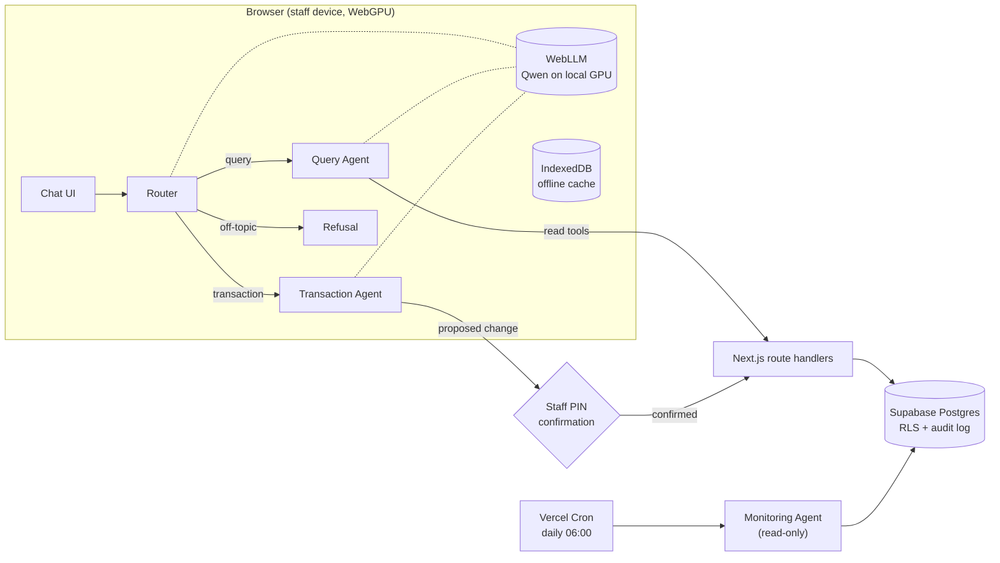
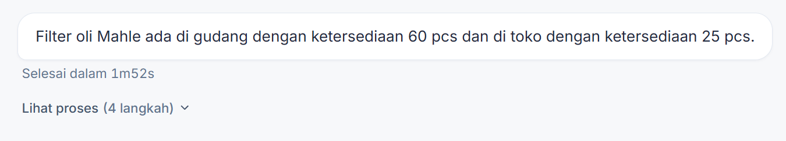
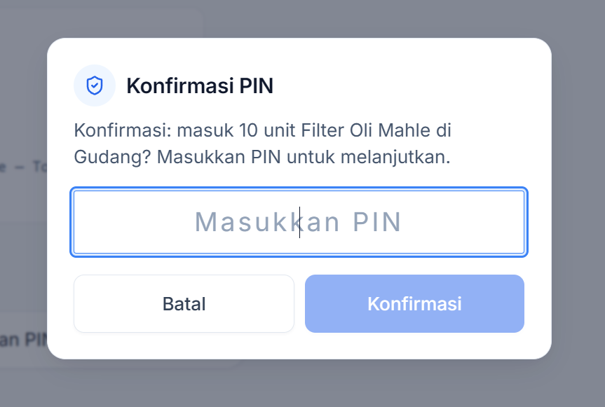
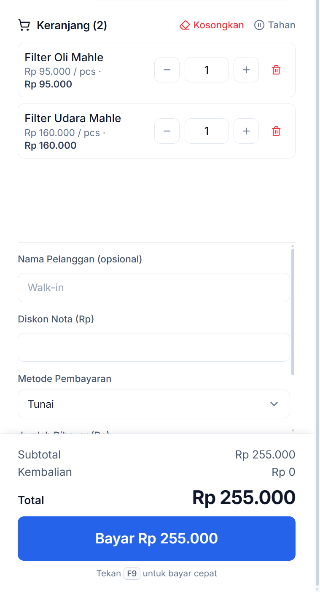
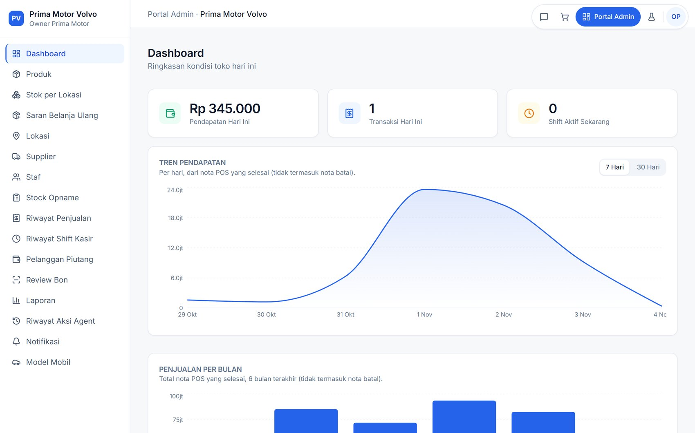

# Stokgent — Prima Motor Intelligence

      

Inventory, point-of-sale, and a **multi-agent chat assistant that runs entirely on the user's own GPU** for a small Volvo spare-parts workshop (Prima Motor). Built for an undergraduate thesis in Informatics. [Bahasa Indonesia](README.id.md)

## Why it matters

A small shop has two stock locations (store and warehouse), a few staff, and no budget for LLM API bills. It also should not send its stock and sales data to a third party. Stokgent runs a small open-weight language model in the browser through WebGPU, so:

- there is no per-request API cost, and no stock data goes to an external LLM service;
- staff ask in plain Indonesian ("how many Mahle oil filters in the warehouse?") or record movements ("10 filters came in to the warehouse");
- the model is never trusted with the database: it proposes, code and a human decide.

## What is novel in the architecture

- **Router + specialist agents, on-device.** A Router picks the Query Agent (stock checks, sales trends), the Transaction Agent (goods in, out, transfer), or an off-topic refusal. Small models do better with narrow prompts than with one giant prompt, and the evaluation below compares this design against a single-agent baseline.
- **The model proposes, code and people decide.** Every stock change from chat must be confirmed with the staff member's PIN before it is written. Numbers shown to the user come from database results through code (`src/lib/agents/`), not from free-form model text.
- **Guardrails around a weak model.** Route guard, off-topic detection, product matching against the real catalog, and system invariants (for example, no stock change without confirmation) hold even when the model misbehaves.
- **Model tiers by GPU.** Three tiers (Saga: Qwen2.5-3B, Ballad: Qwen3-1.7B, Tanka: Qwen3.5-0.8B), each with an f16 and an f32 variant. Devices whose GPU cannot hold the default model are stepped down automatically (`src/lib/agents/gpu-compat.ts`).
- **Multi-tenant through Row Level Security.** Supabase Postgres with RLS per business, staff login by store code + username + PIN, and an audit log of agent actions.
- **Offline-first PWA.** Service worker plus IndexedDB cache; pending chat messages are queued and replayed.
- **A Monitoring Agent that cannot change stock.** A daily Vercel Cron job computes reorder points and writes restock suggestions and notifications. It never writes stock.

## Architecture



## Screenshots

| Chat answer | PIN confirmation |
|---|---|
|  |  |

| Point of sale | Admin dashboard |
|---|---|
|  |  |

The UI is in Indonesian.

## Features

- **Two-location stock**: stock check, stock card per item, transfers, stock opname, reorder suggestions.
- **POS**: shifts, sales, split payments, customers with credit, warranty claims, receipts. See [POS_README.md](POS_README.md).
- **Chat assistant** (`/chat`) with an expandable process trace for each answer.
- **Evaluation harness** (`/eval`): runs scenarios in multi-agent and single-agent mode in the browser and exports JSON/CSV.
- **UI**: light/dark/system theme and a display density setting.

## Evaluation (official run M3, 9 Oct 2026)

50 scenarios run in both modes (100 executions) with `Qwen2.5-3B-Instruct-q4f16_1`, on a Snapdragon device (Adreno 7xx GPU). Paired comparison on the 44 functional scenarios complete in both modes:

| Metric | Multi-agent | Single-agent |
|---|---|---|
| Routing Macro F1 | 0.979 | 0.979 |
| End-to-end task success (ETSR) | 40/44 (90.9%) | 39/44 (88.6%) |
| System-invariant safety checks | 6/6 | 6/6 |
| Median latency | 98 s | 152 s |

Accuracy is statistically indistinguishable (McNemar exact test on ETSR, p = 1.000). Multi-agent is faster on the same scenarios (Wilcoxon signed-rank, p < 0.001; median difference -59 s). The sample is small (44 paired scenarios), so a high p-value does not prove the two modes are equivalent. Later fixes were evaluated in further runs and are reported in the thesis.

## Tech stack

Next.js 16 (App Router), React 19, TypeScript, Tailwind CSS, Supabase (Postgres, Auth, RLS, Storage), WebLLM (`@mlc-ai/web-llm`), PWA (Serwist, IndexedDB), Web Push. Package manager: Bun.

## Quick start

```bash
bun install
```

Create `.env.local` (never commit it):

| Variable | Purpose |
|---|---|
| `NEXT_PUBLIC_SUPABASE_URL`, `NEXT_PUBLIC_SUPABASE_ANON_KEY` | Supabase from the browser |
| `SUPABASE_SERVICE_ROLE_KEY` | server routes that must bypass RLS (PIN confirmation, cron, login) |
| `STAFF_AUTH_EMAIL_DOMAIN` | synthetic email domain for staff accounts |
| `CRON_SECRET` | required by `/api/cron/monitor`; without it cron requests are always rejected |
| `VAPID_PUBLIC_KEY`, `VAPID_PRIVATE_KEY`, `NEXT_PUBLIC_VAPID_PUBLIC_KEY`, `VAPID_SUBJECT` | push notifications |
| `GEMINI_API_KEY`, `OCR_RATE_LIMIT_MAX`, `OCR_RATE_LIMIT_WINDOW_MINUTES` | receipt import by OCR |
| `ENABLE_EVAL_PAGE` | `true` enables `/eval` (evaluation tenant only) |
| `SEED_STAFF_PIN` | optional PIN (6+ digits) for seeded eval accounts |

Then apply `supabase/migrations/` in order (`0001` to `0040`) with the Supabase CLI or the SQL editor, and run:

```bash
bun dev
```

The chat assistant needs a WebGPU browser (recent Chrome or Edge) and enough GPU memory (Qwen2.5-3B q4f16 needs about 2.5 GB). The model downloads once and stays in the browser cache. See [docs/system-requirements.md](docs/system-requirements.md).

## Reproducing the evaluation

`supabase/seed_eval.sql` creates a separate tenant (`eval-prima-motor`, 17 synthetic products, two locations, six months of sales history) so scenarios never touch real shop data. Scenarios live in `src/lib/eval/scenarios.json`.

```bash
bun scripts/eval-report.ts <result.json> --out <folder>
bun scripts/eval-compare.ts <before.json> <after.json> --out compare.md
```

More detail (resuming a run on another machine, seed handling) is in [README.id.md](README.id.md).

## Tests

```bash
bunx vitest run
bun run lint
```

Use `vitest`, not `bun test`: some files import the Next.js-provided `server-only` package, which the Bun runner cannot load.

## Project structure

| Folder | Contents |
|---|---|
| `src/app/` | pages (App Router) and API routes (`api/agent`, `api/admin`, `api/cron`, `api/eval`, ...) |
| `src/lib/agents/` | Router, agents, tool-call protocol, guardrails, code-generated answers; one turn flow in `turn/` |
| `src/lib/eval/`, `src/components/eval/` | scenarios, scoring, and the `/eval` page |
| `src/modules/` | admin and POS modules (`data/`, `services/`, `hooks/`, `mappers/`) |
| `src/components/chat/` | chat UI |
| `supabase/` | migrations, eval tenant seed, RLS integration tests |
| `docs/` | branch map, UX audits, screenshots |

## License

Copyright (c) 2026 Aldian Yohanes. All rights reserved. The source is published for viewing and academic review; see [LICENSE](LICENSE).
